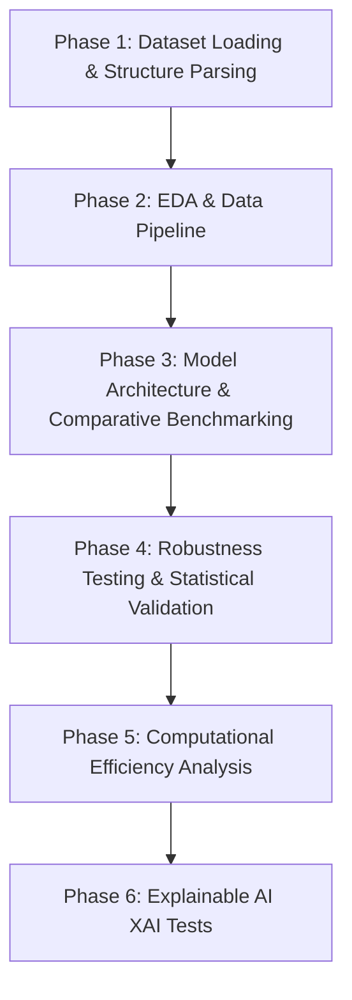

# Black Gram Leaf Disease Classification using LightBASNeSt — Official Implementation

This repository contains the official Jupyter Notebooks for the **LightBASNeSt: A Lightweight Boundary-Aware Split-Attention Network for Black Gram Leaf Disease Classification** framework and its baseline comparative experiments, as presented in our research paper.

## Repository Structure

```text
├── code/
│   ├── BlckGrm_D1.ipynb       # Dataset1 results
│   ├── BlckGrm_D2.ipynb       # Dataset2 results
│   ├── LighBASNeSt.ipynb      # Proposed Model implementation
└── README.md                  # Project documentation
```

---

## Datasets

Raw images are not included in this repository due to storage and licensing constraints. Please acquire the datasets from the official sources or configure your local folder structure as follows:

### Dataset 1: Black Gram Plant Leaf Disease Dataset (BPLD)
* **Title**: Blackgram Plant Leaf Disease Dataset
* **Link**: [https://doi.org/10.17632/zfcv9fmrgv.3](https://doi.org/10.17632/zfcv9fmrgv.3)
* **Total Images**: 1,007 images across 5 distinct diagnostic categories.
* **Class Distribution**:
  * Anthracnose: 230 images
  * Healthy: 221 images
  * Leaf Crinckle: 152 images
  * Powdery Mildew: 180 images
  * Yellow Mosaic: 224 images

### Dataset 2: Mendeley Black Gram Dataset
* **Title**: Image Dataset for Disease Detection in Black Gram (Vigna mungo) Leaves: A Resource for Machine Learning Research
* **Link**: [https://doi.org/10.17632/z55yrbmn2d.3](https://doi.org/10.17632/z55yrbmn2d.3)
* **Total Samples**: 4,038 images across 5 categories.
* **Class Distribution**:
  * Healthy: 545 images
  * Cercospora leaf spot: 598 images
  * Leaf Crinkle: 806 images
  * Insect: 408 images
  * Yellow Mosaic: 1,681 images

---

## Setup and Usage

1. **Clone the Repository**:
   ```bash
   git clone [https://github.com/Samilzabid/BlackGrm_Paper.git](https://github.com/Samilzabid/BlackGrm_Paper.git)
   cd BlackGrm_Paper
   ```
2. **Dependencies and Installation**:

Ensure you have Python 3.8+ installed on your system. The project relies on several core machine learning, computer vision, and data processing libraries. 

You can install all the required dependencies using `pip`:

```bash
pip install torch torchvision numpy pandas matplotlib seaborn scikit-learn opencv-python Pillow tqdm albumentations
```
3. **Directory Configuration**:
   Download and extract the datasets into your local machine (e.g., `D:/BPLD Dataset/Original`).

4. **Run the Code**:
   * Open the desired notebook inside the `code/` directory.
   * Update the dataset path variable in the configuration cell:
     ```python
     data_dir = "D:\\BPLD Dataset\\Original"  # Replace with your dataset path
     ```
   * Execute all cells sequentially to reproduce data preprocessing, training, evaluation, and XAI visualizations.

---

## Structural Flow Diagram



## Project Pipeline Phases

### Phase 1: Dataset Loading & Structure Parsing
* **Recursive Folder Scanning**: The dataset directory is scanned using `os.listdir()` to identify class labels (`fold`) and extract all file paths (`filepaths`).
* **Structured Storage**: Data paths and class associations are stored in a Pandas DataFrame.

### Phase 2: Exploratory Data Analysis (EDA) & Data Pipeline
* **Class Distribution Visualization**: A bar chart with custom hatching patterns (`/`, `\`, `|`, `-`, `+`) is generated to inspect class balance across the categories and saved to disk.
* **Dataset Partitioning**: `train_test_split` from `sklearn.model_selection` stratifies images into training (80%), validation (10%), and testing (10%) sets.
* **Data Transformations & Loading**: `torchvision.transforms` resizes images, applies data augmentation (random rotation, horizontal flips, color jitter), normalizes tensor values using ImageNet statistics, and passes them to PyTorch `DataLoader` objects.

### Phase 3: Model Architecture & Comparative Benchmarking
To demonstrate the superiority of the proposed architecture, multiple standard backbones are evaluated under identical training conditions:
* **Baselines**: AlexNet, VGG16, VGG19, ResNet50, and MobileNetV2.
* **Optimization & Loss**:
  * **Loss Function**: Cross-Entropy Loss (`nn.CrossEntropyLoss`).
  * **Optimizer**: Adam / AdamW with initial learning rate $10^{-4}$.
* **Evaluation Metrics**:
  * Accuracy, Precision, Recall, Macro/Micro $F_1$-score via `classification_report`.
  * Multi-class Confusion Matrix using `seaborn.heatmap`.
  * One-vs-Rest Receiver Operating Characteristic (ROC-AUC) curves and Precision-Recall (PR) curves via `sklearn.metrics`.

### Phase 4: Robustness Testing & Statistical Validation
* **Robustness Evaluation**:
  * **Noise Perturbation**: Gaussian noise, Salt-and-Pepper noise, and Speckle noise are added at varying intensity levels ($\sigma \in [0.05, 0.25]$) to simulate real-world field conditions.
  * **Environmental Variations**: Color jitter, contrast variation, and motion blur are injected using OpenCV (`cv2`).
* **Statistical Validation**:
  * **$K$-Fold Cross-Validation**: 5-Fold cross-validation assesses variance across data splits.
  * **Significance Testing**: Paired Student’s $t$-test and Wilcoxon signed-rank tests compare performance differences between the proposed model and baselines ($p < 0.05$).

### Phase 5: Computational Efficiency Analysis
* **Parameter Count & Memory**: Total trainable parameters and model memory footprints are recorded.
* **FLOPs Computation**: Floating Point Operations per second are measured to evaluate suitability for edge-device deployment.
* **Inference Latency**: Average per-image inference time (milliseconds) is benchmarked across CPU and GPU runtime environments.

### Phase 6: Explainable AI (XAI) Tests
To ensure the network relies on relevant biological features rather than background artifacts:
* **Qualitative Explainability**:
  * **Grad-CAM**: Generates class activation maps from the final convolutional layer to highlight diseased leaf regions.
  * **SHAP (SHapley Additive exPlanations)**: Computes pixel-level feature attribution scores.
* **Quantitative Explainability**:
  * **Deletion / Insertion Scores**: Measures accuracy decay when high-attribution pixels are progressively masked vs. inserted.
  * **Confidence Drop Test**: Quantifies confidence drop when input images are cropped strictly to the activation bounding box identified by Grad-CAM.

---
